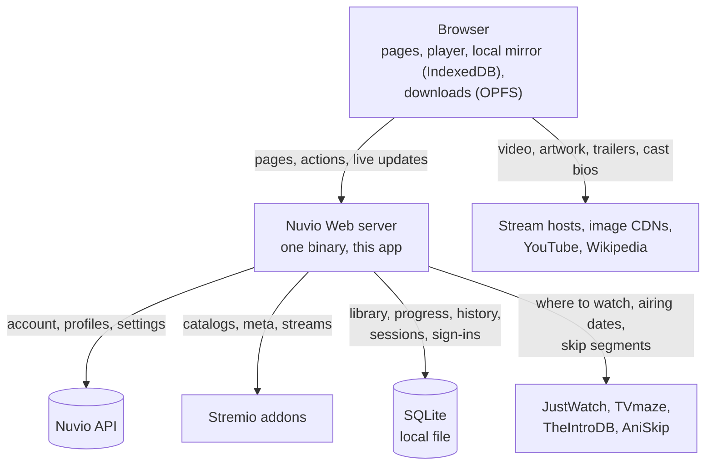
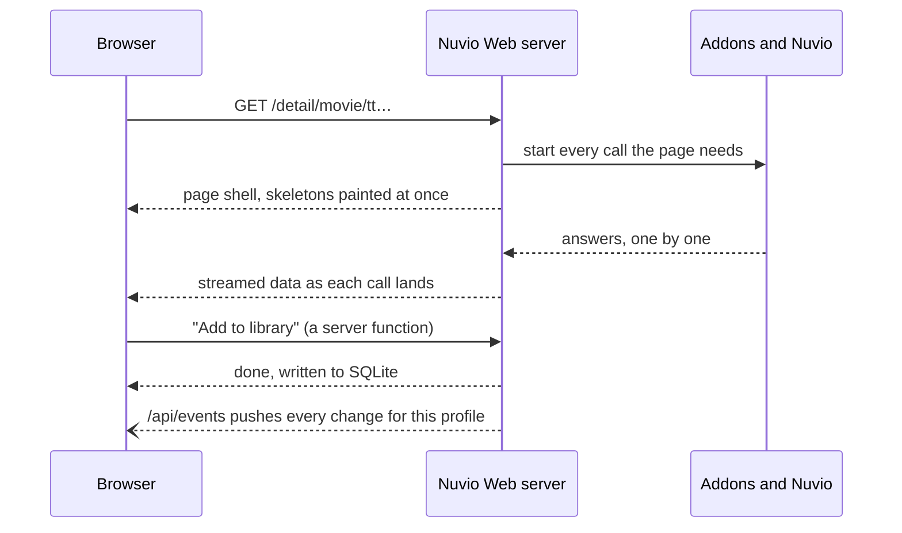
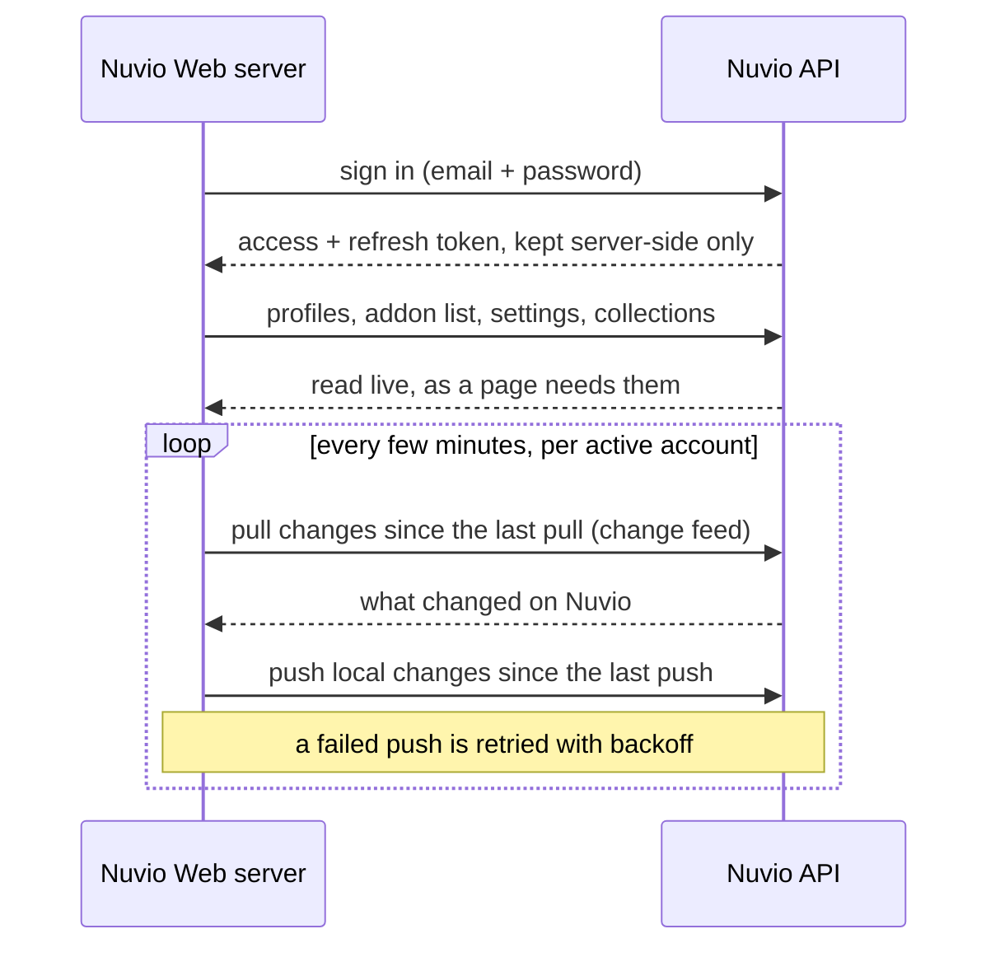
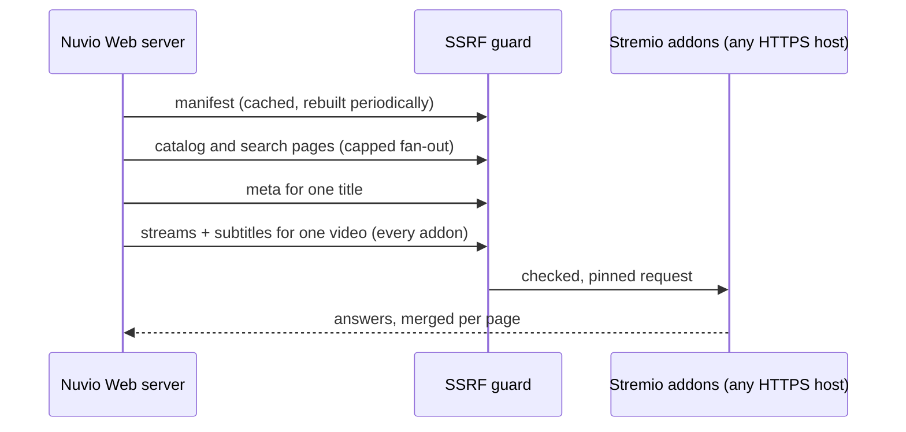
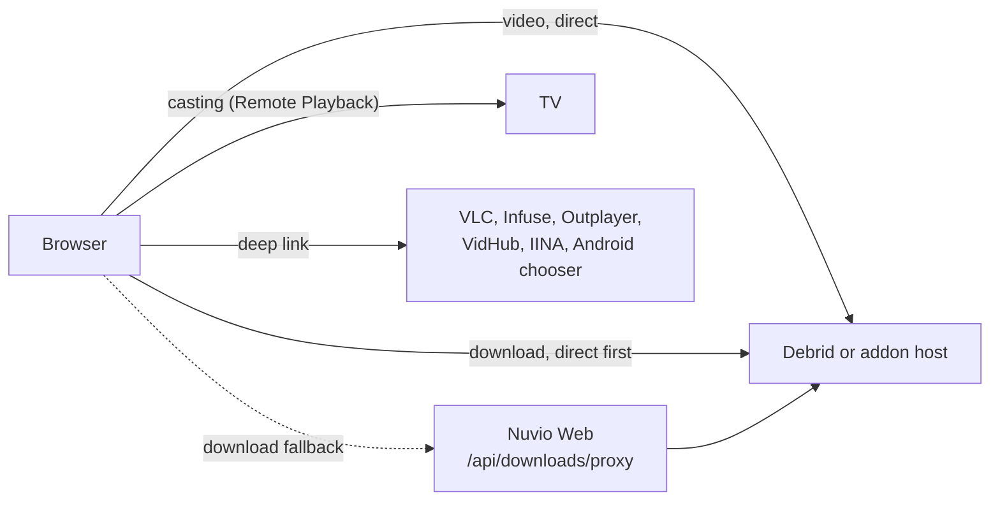
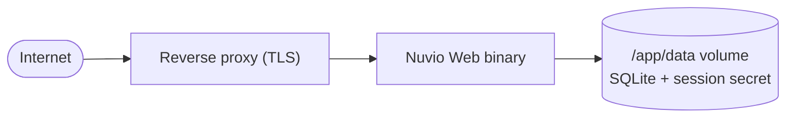

# Architecture

Nuvio Web is one server process sitting between your browser and everything it
needs: your Nuvio account, the Stremio addons you installed, a small local
database, and a handful of public metadata services. This page is about who
talks to whom, over what, and where each piece of data lives.

## The big picture

Two rules shape everything else:

- **The server fetches what a page shows.** Addon catalogs, a title's metadata,
  search results: the server starts fetching them as soon as it knows the URL,
  and streams them to the page as they arrive. The browser never waits for a
  page to load before asking for that page's own data.
- **Video never goes through the server.** Once a source is picked, the browser
  plays it straight from the host the addon pointed at.

## Browser and server

- **Pages.** The first visit is server-rendered; later navigations fetch only
  the page's data. Either way the response streams: the page paints its skeleton
  first and each part fills in when its upstream call returns.
- **Actions.** Buttons and gestures (add to library, mark watched, "load more",
  the source list) call small server functions over HTTP.
- **Live updates.** Each open tab holds one server-sent event connection. Any
  change to the profile (from another tab, another device through this server,
  or pulled from Nuvio) is pushed down it immediately. Tabs also poll as a
  safety net. [Sync](sync) has the details.
- **Local mirror.** The tab keeps library, progress and history in IndexedDB and
  writes there first, so the UI answers instantly and keeps working through a
  dropped connection; a queue sends the writes to the server.
- **Browser cache.** Addon metadata (a title's page, Discover, the drawer's
  header) is cached by the browser for 15 minutes, privately and per session.
  Nothing is cached on the server.
- **Offline.** A service worker keeps the app's own files and an offline page.
  It never caches signed-in pages.

## Server and Nuvio

- **Sign-in.** The browser sends credentials to this server, which signs in to
  Nuvio. The Nuvio tokens never reach the browser; its cookie only carries a
  signed session id. One component owns refreshing tokens, because Nuvio's
  refresh tokens rotate and a second refresher would sign the user out.
- **Live reads.** Profiles, installed addons, settings and collections stay on
  Nuvio and are read from it when a page needs them.
- **Mirrored data.** Library, watch progress and history are the exception: this
  server's database is their source of truth, and Nuvio is kept as a mirror so
  the mobile app sees the same thing. The first visit copies them from Nuvio;
  after that, a background sync pulls and pushes every few minutes while the
  account is active.

## Server and addons

Addons are plain HTTP services the user chose to install, so every request to
them goes through an SSRF guard: private, loopback and link-local addresses are
refused, every redirect is re-checked, and the connection is pinned to the
address that was checked. Requests fan out with a concurrency cap, and one slow
or broken addon degrades its own row rather than the page.
[Addon pipeline](addon-pipeline) covers how their answers are merged.

## The database

One SQLite file on the server's data volume. It holds:

| What                         | Why it is here                                 |
| ---------------------------- | ---------------------------------------------- |
| Library, progress, history   | Source of truth, mirrored to Nuvio             |
| The outbox of unsent changes | What the next push to Nuvio still has to send  |
| Sessions                     | The Nuvio tokens behind each signed session id |
| Sign-ins and their audit log | The admin page's activity view                 |
| Allowlist and instance lock  | Who may sign in to this instance               |

Nothing in it is needed to rebuild a Nuvio account: losing the file loses
unsynced changes and sessions (everyone signs in again), and the next visit
copies library, progress and history back from Nuvio.

## Other services

| Service                  | Called by | For                                            |
| ------------------------ | --------- | ---------------------------------------------- |
| JustWatch                | server    | "Where to watch" and the official Watch button |
| TVmaze                   | server    | When the next episode airs                     |
| TheIntroDB, AniSkip, ARM | server    | Skip intro / outro segments                    |
| Wikipedia                | browser   | Cast photos and short biographies              |
| YouTube (no-cookie)      | browser   | Trailers                                       |
| Image hosts (TMDB, …)    | browser   | Posters and backdrops addons point at          |

Wikipedia is called from the browser on purpose: it allows any origin, so no
biography text passes through the server, and a shared request budget keeps a
long cast list from opening dozens of connections.

## Playback and downloads

- **Playback** fetches the stream directly. The server only resolves which
  sources exist.
- **Downloads** also go direct and are stored in the browser's private file
  system (OPFS) for offline viewing. The server's download proxy is a fallback
  for hosts the browser can't reach itself (no CORS, or plain `http:` under an
  `https:` page). It requires a session and applies the same SSRF guard.
- **External players** get the stream URL through a deep link; nothing about
  that playback comes back to the server, so it isn't tracked.

## Deployment

- **One binary.** The app and its runtime compile into a single executable,
  shipped on a slim Debian base with `curl` for the health check.
- **One volume.** `/app/data` holds the SQLite file and the generated session
  secret, the only state on disk. Back it up, or accept everyone signing in
  again and a re-copy from Nuvio.
- **The proxy** must not buffer `/api/events` (the server sends
  `X-Accel-Buffering: no` and a keep-alive every 25 seconds).
- **The origin** is fixed at build time. The published image takes the host from
  the request and assumes `https://`; plain HTTP needs a build with the origin
  baked in ([Configuration](configuration)).
- **Health check:** `GET /api/health` answers as long as the process does.
